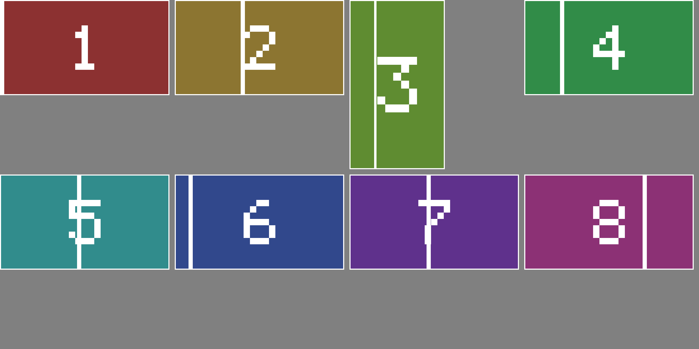

# jitsi-ndi

**Versión 0.1.0 · Prueba de señales NDI**



## Español

### Qué es

jitsi-ndi es la pieza de recepción del **TCRV (Teatro de Creación Remota en Vivo)**: una reunión en Jitsi donde el elenco conversa, ensaya y crea desde sus teléfonos, mientras la máquina de la dirección multimedia recibe la cámara de cada participante como una señal NDI separada para el mixer TCRV en TouchDesigner.

Reemplaza la salida NDI por participante que antes daba Skype, con software libre y sin cuentas.

### Cómo funciona

- **Artistas:** entran a la sala de Jitsi desde su teléfono (app de Jitsi o navegador), con audio y video. No instalan nada especial.
- **Dirección multimedia (host):** está en la misma sala. Su cámara es la salida del mixer (NDI Webcam Input), para que el elenco vea el resultado.
- **jitsi-ndi:** corre en la máquina del host, entra a la sala como receptor silencioso y publica una señal NDI por participante (360p, solo video), con el nombre de cada persona, para recibirla con un NDI In TOP.

### Estado y hoja de ruta

| Paso | Qué | Estado |
|---|---|---|
| 1 | Prueba NDI desde Node: 8 señales hacia TouchDesigner | **v0.1 ✓** |
| 2 | Servidor Jitsi propio (docker-jitsi-meet), máximo 360p | **v0.2: local ✓** |
| 3 | App Electron con lib-jitsi-meet que entra a la sala sin cámara ni micrófono | pendiente |
| 4 | Una salida NDI por participante, con nombre fijo por persona | pendiente |
| 5 | Prueba con 8 teléfonos reales, empaquetado `.exe` | pendiente |
| 6 | Versión para macOS | pendiente |

### Prueba NDI (paso 1)

Requisitos en Windows:

1. [Node.js LTS](https://nodejs.org/)
2. Visual Studio Build Tools con la carga «Desarrollo para el escritorio con C++» (para compilar el módulo NDI)
3. [NDI Tools](https://ndi.video/tools/) (incluye el runtime de NDI y Studio Monitor para revisar)

Instalar y correr (en una carpeta **sin espacios** en la ruta, por ejemplo `C:\dev`: con Node 24 o más nuevo, un espacio como en `C:\Users\Mi PC` rompe la compilación del módulo NDI):

```bash
cd C:\dev
git clone https://github.com/loquellega/jitsi-ndi.git
cd jitsi-ndi
npm install          # descarga el NDI SDK y compila el módulo
npm run prueba       # publica 8 señales; Ctrl+C para terminar
```

En TouchDesigner, crea un **NDI In TOP** y elige la fuente `TU-PC (TCRV Prueba 1)`, `…2`, etc. Cada señal tiene su color, su número y una barra que se mueve. La señal 3 es vertical (360×640), como un teléfono parado.

Opciones:

```bash
node prueba/senales-prueba.js --n 4 --w 640 --h 360 --fps 30 --verticales 3,5
npm run prueba:verificar   # prueba automática: publica, busca las señales y recibe un cuadro
```

Si Windows pregunta por el firewall la primera vez, permite el acceso en redes privadas: NDI lo necesita.

### Servidor Jitsi local (paso 2)

Requiere [Docker Desktop](https://www.docker.com/products/docker-desktop/) abierto. En una terminal **de administrador**, desde la carpeta del repo:

```powershell
powershell -ExecutionPolicy Bypass -File servidor\preparar.ps1
cd servidor\jitsi
docker compose up -d
```

Abre `https://IP-DE-LA-PC:8443/tcrv-prueba` tanto en la PC como en los teléfonos (misma Wi-Fi); con `localhost` la reunión se desconecta. El certificado es de prueba: acepta el aviso del navegador. Para apagar: `docker compose down`.

---

## English

### What it is

jitsi-ndi is the receiving piece of **TCRV (Live Remote Creation Theater)**: a Jitsi meeting where the cast talks, rehearses and creates from their phones, while the media director's machine receives each participant's camera as a separate NDI source for the TCRV mixer in TouchDesigner.

It replaces the per-participant NDI output Skype used to provide, with free software and no accounts.

### How it works

- **Artists** join the Jitsi room from their phones (Jitsi app or browser), with audio and video. Nothing special to install.
- **Media director (host)** is in the same room; their camera is the mixer output (NDI Webcam Input), so the cast sees the result.
- **jitsi-ndi** runs on the host machine, joins the room as a silent receiver and publishes one NDI source per participant (360p, video only), named after each person, ready for an NDI In TOP.

### NDI test (step 1)

Requires Node.js LTS, Visual Studio Build Tools (C++ desktop workload) and NDI Tools. Then:

```bash
npm install
npm run prueba
```

In TouchDesigner, add an **NDI In TOP** and pick `YOUR-PC (TCRV Prueba 1)`, `…2`, and so on. Source 3 is portrait (360×640), like an upright phone.

## Capturas / Screenshots

| | | |
|---|---|---|
|  | | |
| Las 8 señales de prueba / The 8 test sources | | |

## Licencia / License

GPL-3.0. El módulo NDI usa [@stagetimerio/grandiose](https://github.com/stagetimerio/grandiose) (Apache-2.0), que descarga el NDI SDK durante la instalación; el SDK y su runtime se rigen por la licencia de NDI y no se incluyen en este repositorio. NDI® es una marca registrada de Vizrt Group.

## Créditos / Credits

Diseño, investigación y desarrollo: Héctor Cruz Juárez — https://hectorcruz.com.mx  
Colección Alchemy of Meaning.
